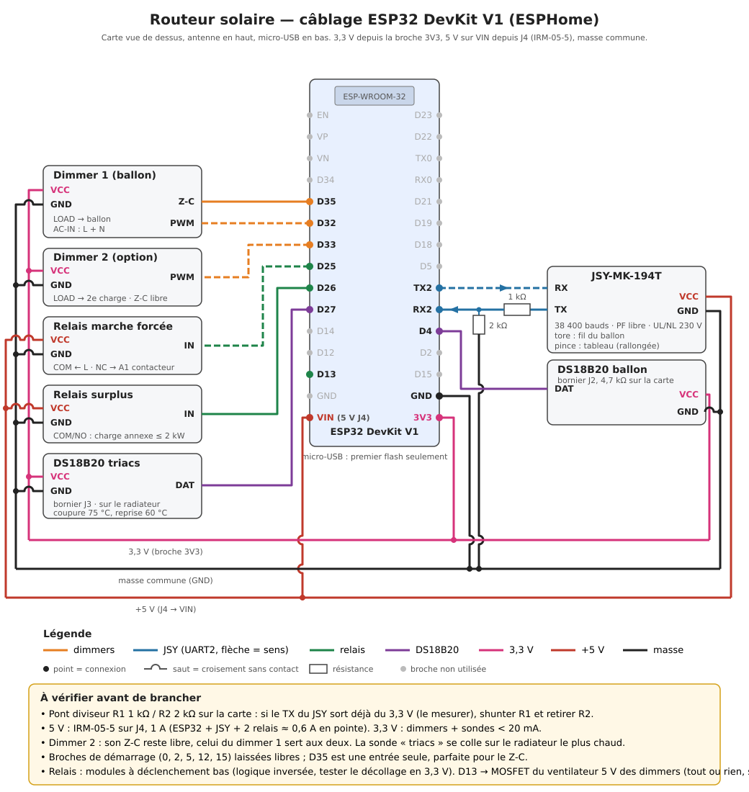
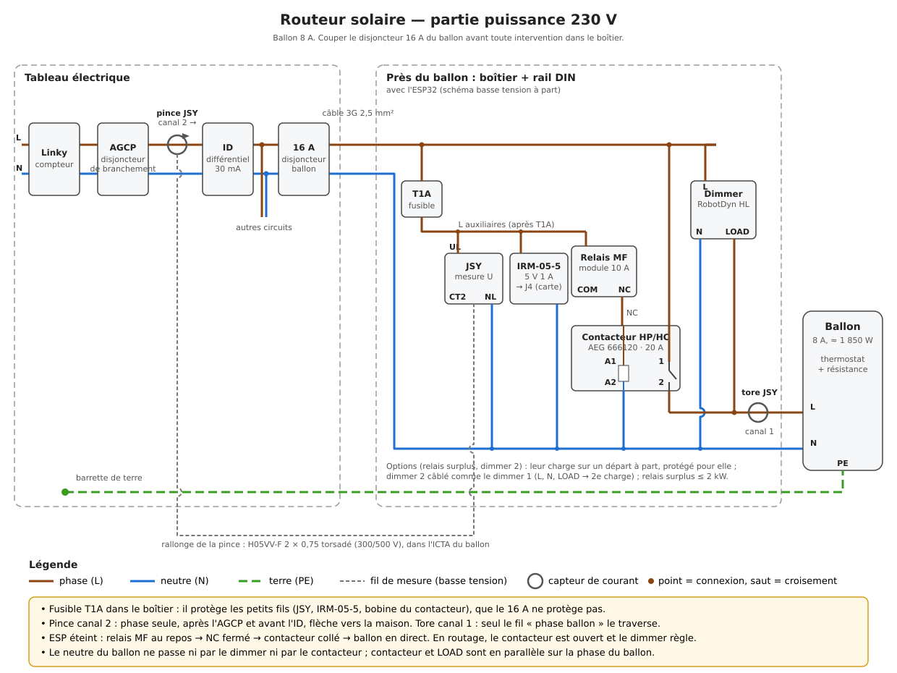

# Routeur solaire — ESPHome sur ESP32 DevKit V1

Portage du routeur Profes'Solaire v9.15 (`esp32_oled_ac_v9_15.ino`) sur un **ESP32 DevKit V1**
(ESP-WROOM-32) sous **ESPHome**, relié à Home Assistant par l'API native. But : envoyer le surplus solaire dans le
ballon d'eau chaude, et garantir de l'eau chaude le soir.

- Gardé : JSY-MK-194T, **2 dimmers** (même table de pas que la v9.15), relais surplus (sortie 3), relais de marche
  forcée, sonde DS18B20 du ballon (désormais déportée en 433 MHz, voir `sonde-433/`).
- Ajouté : sonde DS18B20 de sécurité sur le radiateur des triacs, détection « ballon chaud », seuils du relais réglables
  depuis HA, anti-légionelle, marche forcée de secours si HA est injoignable.
- Retiré : écran OLED, page web ESP-DASH, topics MQTT `mosquitto/...`, relais Bluetooth (routeur dédié au routage).
- **Deux cœurs** : wifi et pile réseau sur le cœur 0 ; boucle ESPHome (JSY, régulation) sur le cœur 1 ;
  triacs pilotés par une interruption de minuterie matérielle.
- Les marches forcées sont faites par des **automatisations Home Assistant** qui lisent les réglages de l'ESP.

Fichiers :
- `esphome/routeur-solaire.yaml` : configuration ESPHome.
- `esphome/routeur-solaire/routeur.h` : décodage du JSY (avec contrôle du CRC Modbus) et table des pas.
- `test/test_routeur.c` : test hors carte de `routeur.h` (`gcc -Wall -o /tmp/t test/test_routeur.c -lm && /tmp/t`).
- `cablage.svg` : schéma de câblage basse tension (ESP, modules, 3,3 V / 5 V / masse).
- `ha-carte-solaire-ecs.yaml` : carte pour la page « Solaire ECS » de HA (coller en carte « Manuel »).
- `outils/vitesse_port_jsy.ino` : passage du JSY de 4 800 à 38 400 bauds (une seule fois, depuis un ESP32).
- `puissance.svg` : schéma de la partie 230 V (tableau, boîtier près du ballon, contacteur, dimmer, ballon).
- `pcb/` : carte mère KiCad générée par script, fichiers de fabrication JLCPCB (voir `pcb/README-pcb.md`).
- `boitier/` : boîtier imprimé 3D OpenSCAD + STL (voir `boitier/README.md`).

Compilé avec ESPHome 2026.10.2 : RAM ≈ 28 %, flash ≈ 49 %. Premier flash : *⋮ → Install → Manual download → Factory format* dans ESPHome, puis
`esptool --chip esp32 --port /dev/ttyUSB0 --baud 460800 write_flash 0x0 routeur-solaire.factory.bin`
(esptool 4.x d'Ubuntu ; Firefox ne sait pas flasher en USB). Ensuite, mises à jour par le wifi.

## Câblage

| Signal | DevKit V1 | GPIO | Remarque |
|---|---|---|---|
| TX du JSY | RX2 | 16 | UART2 matérielle, pont diviseur R1/R2 sur la carte |
| RX du JSY | TX2 | 17 | |
| Z-C (dimmer 1) | D35 | 35 | entrée seule ; commun aux deux dimmers, Z-C du dimmer 2 non branché |
| PWM dimmer 1 (ballon) | D32 | 32 | |
| PWM dimmer 2 (option) | D33 | 33 | 2e charge ; activer « Sortie 2 active » dans HA |
| Relais marche forcée | D25 | 25 | NC → bobine du contacteur |
| Relais surplus | D26 | 26 | |
| Récepteur 433 MHz SRX882 (DATA) | D4 | 4 | bornier J2 ; reçoit la sonde déportée du ballon (`sonde-433/`) |
| DS18B20 triacs (DAT) | D27 | 27 | bus séparé, bornier J3 |
| Ventilateur 5 V des dimmers | D13 | 13 | MOSFET Q1 de la carte : marche au seuil (45 °C, réglable), arrêt 7 °C plus bas, forcé si la sonde des triacs se tait |

- Aucune broche de démarrage (0, 2, 5, 12, 15) n'est utilisée : rien ne s'active au boot ni pendant un flash USB.
- Les logs passent par le port USB (UART0) et le tableau de bord ESPHome ; le JSY a sa propre UART.
- La sonde des triacs a son propre fil : une panne sur un bus ne fait pas perdre l'autre sonde.
- TX du JSY → RX2 par le pont diviseur de la carte, 1 kΩ (R1, en série) / 2 kΩ (R2, vers la masse) : 5 V × 2/3 = 3,3 V.
  Si le TX du JSY sort déjà du 3,3 V (le mesurer au repos), remplacer R1 par un pont de soudure et retirer R2.
- 5 V : alimentation Mean Well IRM-05-5 dans le boîtier → bornier J4 de la carte → VIN de l'ESP, JSY, relais, ventilateur.
  3,3 V (dimmers, sondes) pris sur la broche 3V3 de l'ESP ; masse commune.

### Matériel

- **JSY-MK-194T déjà passé à 38 400 bauds** par `outils/vitesse_port_jsy.ino` (croquis ESP32 : requête Modbus en
  diffusion, registre 0x0004 = 0x0108, soit adresse 1 et code vitesse 8 = 38 400). C'est la vitesse et l'adresse
  qu'attend ESPHome ; c'est aussi la vitesse maximale du JSY, à garder (≈ 18 ms par échange, contre ≈ 144 ms à
  4 800 bauds, plus que le cycle de 120 ms). Un JSY neuf ou remis à zéro est à 4 800 bauds : bouton
  « JSY : passer à 38 400 bauds » dans HA (diagnostics de l'appareil, **masqué par défaut** : l'activer d'abord). Il
  coupe le dimmer, envoie la trame de réglage à 4 800 puis à 9 600 bauds, revient à 38 400 et écrit dans les logs si
  les mesures sont revenues. Le croquis reste utile sans ESPHome.
- **JSY-MK-194T** : broches VCC, RX, TX, PF, GND (PF non branchée). Canal 1 = tore intégré, à faire traverser par le fil
  du ballon ; canal 2 = pince externe sur l'arrivée générale ; UL/NL = 230 V pour la mesure de tension.
- **Sonde DS18B20 des triacs** (VCC, DAT, GND) sur le bornier J3, en 3,3 V : la résistance de tirage 4,7 kΩ est sur la
  carte (R4), ne pas en ajouter.
- **Sonde du ballon déportée** : le routeur est près du tableau, à ~10 m du ballon, et 10 m de câble 1-Wire le long de
  l'alimentation du ballon donnent des lectures fausses. Elle est lue sur place par un Pro Mini sur 18650 qui l'envoie en
  433 MHz (`sonde-433/README.md`). Récepteur **SRX882** sur J2 : VCC → 3,3 V, DATA → DAT, GND, **CS → 3,3 V**, antenne
  de 17,3 cm hors du tableau métallique. Entités `Batterie sonde ballon` et `Sonde ballon` (connectivité).
- **Ballon : 8 A (≈ 1 850 W)**, circuit dédié au tableau : différentiel 30 mA → disjoncteur 16 A → câble 3G 2,5 mm²
  jusqu'au ballon. Raccordement par une sortie de câble puis les presse-étoupes du boîtier, **pas de prise** (une prise
  chauffe sous une charge résistive de plusieurs heures par jour).
- **Relais : modules 5 V 10 A à déclenchement bas** (Songle SRD-05VDC-SL-C, broches IN / GND / VCC, bobine ≈ 70 mA),
  enfichés sur K1 (marche forcée) et K2 (surplus).
  - Relais surplus : contact NO vers une charge annexe de 2 kW au plus (au-delà, passer par un contacteur).
  - Relais marche forcée : il ne coupe pas le ballon lui-même, il pilote la **bobine du contacteur** par son
    contact **NC** : COM ← L, NC → A1 du contacteur, A2 → N. ESP éteint ou en panne = relais au repos = contacteur
    collé = ballon en direct sur son thermostat. En routage, la bobine du petit relais est alimentée en permanence.
  - Réglages pour ces modules, à poser dans `substitutions` au montage : `relais_surplus_inverse: "true"`,
    `relais_mf_inverse: "false"` (le fichier a encore les valeurs d'un module à déclenchement haut, l'inverse).
  - **Piège** : alimentés en 5 V, ces modules peuvent ne pas décoller avec les 3,3 V de l'ESP (pour leur transistor,
    3,3 V est encore un niveau bas). Test au banc avant montage : IN à la masse → le relais colle ; IN en l'air → il
    doit décoller franchement. S'il reste collé avec la broche de l'ESP à 3,3 V : passer les sorties en `open_drain`,
    ou souder une diode 1N4148 en série sur IN (cathode côté ESP).
- **Contacteur jour/nuit AEG 666120** (20 A, 2 NO, bobine 230 V, commutateur 0 / AUTO / 1) : sur rail DIN près du
  ballon. Son contact de puissance relie L à la phase du ballon, en parallèle de la sortie LOAD du dimmer : en marche
  forcée, le triac est court-circuité. Commutateur sur **AUTO** ; **1** = marche forcée manuelle, même ESP en panne ;
  **0** = ballon coupé.
- **Pince du canal 2 (arrivée générale), rallongée jusqu'au tableau** — le boîtier est près du ballon :
  - Câble : **H05VV-F 2 × 0,75 mm²** (isolé 300/500 V), torsadé à la main (un tour tous les 5 à 10 cm), ou sa version
    blindée (blindage relié à la masse côté JSY seulement). Une pince à sortie courant supporte sans souci 10 à 20 m.
  - Passage : dans la même gaine ICTA que le câble du ballon, ou fixé le long d'elle. Les fils de la pince sont reliés
    au circuit de mesure du JSY, référencé au secteur : les traiter comme du 230 V (pas de câble Ethernet).
  - Raccord : souder et gainer (thermorétractable), ou bornier dans une boîte ; garder la fiche d'origine côté JSY.
  - **Ne jamais laisser la pince fermée sur un câble sous tension avec ses fils débranchés** (secondaire de
    transformateur de courant ouvert = tension élevée, pince abîmée) : brancher d'abord la rallonge, puis clipser.
  - Pose : autour de la **phase seule** de l'arrivée générale, après le compteur et avant tous les départs.
    Flèche de la pince dans le sens compteur → maison.
  - Contrôle : la nuit (aucune production), `Puissance réseau` doit être **positive** dans HA. Si elle est
    négative, retourner la pince.
- **Alimentation 5 V** : Mean Well IRM-05-5 (5 V 1 A, classe II) dans le boîtier, derrière un fusible **T1A** temporisé
  sur la phase (porte-fusible de façade 250 V) ; le même fusible protège les fils L/N du JSY. Sortie sur J4 (bornier
  débrochable 2 points, pas de 3,5 mm), protégée sur la carte par F1 (PTC 1,1 A) et D2. ≈ 0,6 A en pointe (ESP32 avec
  wifi, JSY, 2 relais, ventilateur). Le micro-USB de l'ESP ne sert plus qu'au premier flash.
- **Dimmer RobotDyn « AC Dimmer Module HL » 16/24 A 600 V** : logique VCC (3,3 V),
  GND, Z-C → D35, PWM → D32 (dimmer 2 : PWM → D33, Z-C libre). Puissance : AC-IN **L** et **N**, sortie **LOAD** vers la phase du ballon ; l'autre fil du
  ballon va directement au neutre. Avec un ballon de 8 A, la version 16 A est à l'aise (≈ 10 W dans le triac) ;
  radiateur à l'air libre, sonde DS18B20 « triacs » collée (pâte ou colle thermique) sur le peigne en aluminium, au plus
  près du triac (avec deux dimmers : sur celui qui chauffe le plus, ou les deux radiateurs serrés l'un contre l'autre).
- Sonde du ballon : en partie haute (doigt de gant ou contre la cuve sous l'isolant), c'est l'eau qui sort au robinet.

## Installation

1. Copier `esphome/routeur-solaire.yaml` et le dossier `esphome/routeur-solaire/` dans la configuration ESPHome.
2. Ajouter à `secrets.yaml` : `wifi_ssid`, `wifi_password`, `routeur_api_key` (clé de 32 octets en base64, par exemple
   `openssl rand -base64 32`) et `routeur_ota_password`.
3. Premier flash par USB (voir plus haut), puis mises à jour par le wifi.
4. Dans HA : *Paramètres → Appareils et services → Ajouter une intégration → ESPHome* (découverte automatique sur le
   même réseau, sinon par l'IP de l'ESP, port 6053), avec la clé d'API. Réserver l'IP de l'ESP dans le DHCP de la box.
5. Créer les automatisations de marche forcée (voir *Fonctionnement*) et le capteur `statistics`
   `sensor.ballon_temperature_max_7_jours` (max sur 7 jours de la température du ballon).
6. Carte de tableau de bord : *Ajouter une carte → Manuel* → coller `ha-carte-solaire-ecs.yaml`.

Réglages dans `substitutions` : `dimmer_max` (95 %), `mf_duree_max` (la marche forcée se coupe seule au bout de 8 h si
HA ne l'a pas fait), `triac_coupure` / `triac_reprise` (75 / 60 °C).

## Fonctionnement

**Routage** (dans l'ESP, toutes les 120 ms) : une consigne unique monte ou descend selon la puissance réseau pour
viser entre −30 et 0 W d'injection, avec la table de pas de la v9.15. De 0 à 95 % elle pilote le dimmer 1 (ballon) ;
au-delà, si « Sortie 2 active » est allumé, le dimmer 2 prend la suite jusqu'à 95 %. À la descente, le dimmer 2 baisse
d'abord, puis le dimmer 1 : pas d'à-coup (la v9.15 remettait la sortie 2 à zéro dès que la 1 quittait son maximum).
« Sortie 2 active » est éteint par défaut : ne l'allumer qu'avec une charge branchée sur le dimmer 2.
Le JSY ne rafraîchit ses mesures que toutes les 330 ms : la consigne n'est corrigée que sur une trame nouvelle
(la v9.15 appliquait le même pas 2 à 3 fois sur la même mesure). 5 s de trames identiques = JSY figé, traité comme muet
(dimmer coupé). Wifi coupé : l'ESP ne redémarre jamais et continue de router seul.

**Marche forcée de secours** : si HA est injoignable à l'heure réglée, l'ESP applique seul la règle « température »
(chauffe si l'eau est sous la consigne, arrêt dès qu'elle l'atteint), avec l'heure de HA ou à défaut l'heure Internet
(SNTP). Quand HA est là, l'ESP le laisse faire.

**Relais surplus** : collé quand surplus (injection + puissance du ballon) > « seuil marche », décollé sous
« seuil arrêt », au moins 60 s entre deux changements. Les deux seuils se règlent dans HA (1000 / 800 W par défaut) :
mettre le seuil de marche à peu près à la puissance de la charge branchée sur ce relais.

**Ballon chaud** : dimmer au maximum mais moins de 30 W dans le ballon pendant 60 s = thermostat du ballon ouvert.
`binary_sensor.sdb_routeur_solaire_ballon_chaud` passe à « on » (levé dès que le ballon reprend plus de 100 W). Le surplus
n'a alors plus que le relais surplus ; le capteur peut aussi servir dans HA (notification, lancer un appareil…).

**Sécurité triac** : radiateur ≥ 75 °C → dimmer coupé, reprise sous 60 °C. Sonde absente ou muette depuis 60 s →
dimmer coupé aussi (sûr par défaut : **sans cette sonde branchée, le routeur ne route pas**). La marche forcée n'est
pas concernée (elle passe par le contacteur, pas par le triac). `binary_sensor.sdb_routeur_solaire_securite_triac`
signale le problème.

**Marches forcées** (automatisations HA, à l'heure réglée sur l'ESP) :

| Automatisation | Quand | Arrêt |
|---|---|---|
| marche forcée température (activée par défaut) | à 16:00 si l'eau est sous 40 °C | dès que l'eau dépasse 40 °C |
| anti-légionelle | à 16:00 si l'eau n'a pas dépassé 60 °C depuis 7 jours | à 60 °C, ou au bout de 6 h |
| marche forcée volume (désactivée par défaut) | à l'heure réglée, si l'énergie routée du jour est sous le besoin du ballon (formules v9.15) | après la durée calculée |

- 16:00 et 40 °C sont les valeurs par défaut de l'ESP, modifiables dans HA ; elles servent à toutes les marches forcées.
- Pendant l'anti-légionelle, l'arrêt à 40 °C de la marche forcée température est suspendu.
- Le max sur 7 jours vient de `sensor.ballon_temperature_max_7_jours` (intégration `statistics`, `configuration.yaml`).
  Juste après la mise en service, il n'a que quelques heures d'historique : un premier cycle à 60 °C est normal.
- Sans sonde du ballon (aucune trame reçue depuis 5 min), ni marche forcée température ni anti-légionelle (la v9.15 lisait −127 °C et chauffait toutes
  les nuits).
- Si HA redémarre pendant une marche forcée volume ou anti-légionelle, l'arrêt est perdu : la sécurité de 8 h de l'ESP coupe.

## Entités Home Assistant

HA préfixe les entités par la pièce de l'appareil (ici `sdb_`, salle de bain) : adapter les noms ci-dessous, les
automatisations et la carte à votre installation.

**Commandes et réglages** (gardés dans la flash de l'ESP, ils survivent aux coupures) :

| Entité | Défaut | v9.15 |
|---|---|---|
| `switch.sdb_routeur_solaire_marche_forcee` | arrêt | bouton « Auto / Marche forcée » (inversé) |
| `switch.sdb_routeur_solaire_programmation_temperature` | marche | « Horloge On/Off température » |
| `switch.sdb_routeur_solaire_programmation_volume` | arrêt | « Horloge On/Off volume » |
| `time.sdb_routeur_solaire_heure_marche_forcee` | 16:00 | curseurs heure / minute |
| `number.sdb_routeur_solaire_temperature_marche_forcee` | 40 °C (10-90, pas de 5) | curseur température |
| `number.sdb_routeur_solaire_volume_ballon` | 200 L | `volume` dans le code |
| `number.sdb_routeur_solaire_relais_surplus_seuil_marche` | 1000 W | `relayOn` dans le code |
| `number.sdb_routeur_solaire_relais_surplus_seuil_arret` | 800 W | `relayOff` dans le code |

**Mesures** — elles remplacent les capteurs du bloc `mqtt:` (l'historique reste sur les anciennes entités) :

| Entité | Ancien capteur MQTT |
|---|---|
| `sensor.sdb_routeur_solaire_puissance_reseau` (W, > 0 soutirage, < 0 injection) | « Consommation » |
| `sensor.sdb_routeur_solaire_puissance_ballon` (W) | « Puissance surplus » |
| `sensor.sdb_routeur_solaire_energie_routee` (kWh, utilisable dans le tableau Énergie) | « Energie sauvée totale » |
| `sensor.sdb_routeur_solaire_energie_reseau_canal_2` (kWh) | « Consommation Enedis totale » |
| `sensor.sdb_routeur_solaire_energie_routee_aujourd_hui` (kWh depuis 4h30 ou le démarrage) | « Energie sauvée aujourd'hui » |
| `sensor.sdb_routeur_solaire_temperature_ballon` (°C, toutes les 30 s) | « Température ballon » |

Nouveaux : `sensor.sdb_routeur_solaire_injection_reseau` (W partis sur le réseau, pince du canal 2),
`sensor.sdb_routeur_solaire_energie_injectee` (kWh, calculée dans l'ESP, gardée en flash : « Retour au réseau » du
tableau Énergie), `sensor.sdb_routeur_solaire_sortie_dimmer` (%), `sensor.sdb_routeur_solaire_temperature_triac` (diagnostic),
`binary_sensor.sdb_routeur_solaire_ballon_chaud`, `…_securite_triac`, `…_relais_surplus`, `…_relais_marche_forcee`,
`…_mesure_jsy` (déconnecté si aucune trame valide depuis 3 s : dimmer coupé), `sensor.ballon_temperature_max_7_jours` (HA).

## Différences avec la v9.15

- Trames JSY vérifiées (longueur, en-tête, CRC). La v9.15 décodait n'importe quoi : une trame tronquée donnait une
  puissance fausse et un saut du dimmer. Sans trame valide pendant 3 s, le dimmer est coupé.
- À 0 W pile, la v9.15 reprenait le pas précédent (aucune condition ne couvrait 0) : ici, pas = 0.
- Dimmer : composant `ac_dimmer` d'ESPHome au lieu de RBDdimmer. La courbe % → angle de phase peut différer un peu ;
  la régulation étant en boucle fermée, ça ne change que la vitesse de convergence.
- Heure fournie par HA (heure d'été comprise ; la v9.15 restait en UTC+1 toute l'année).
- Marche forcée par défaut à 16:00 sous 40 °C (pour l'eau du soir) au lieu de 01:30 sous 50 °C.

## Reste à vérifier sur la carte

- Boot normal avec tout le câblage branché.
- Valeurs du JSY cohérentes dans HA (tension ~230 V, signe de la puissance réseau).
- Dimmer qui suit le surplus sans osciller. Sinon, réduire les pas dans `routeur.h` ou monter l'intervalle de 120 ms.
- Sens du zéro crossing : si le dimmer scintille ou reste éteint, essayer `inverted: true` sur `zero_cross_pin`.
- « Ballon chaud » qui passe bien à « on » quand le thermostat coupe (ballon à 0 W, dimmer à 95 %).
- Température du triac en plein soleil (8 A pendant des heures) : elle doit rester nettement sous 75 °C.
- Relais marche forcée : ESP débranché → le contacteur colle ; ESP en routage → il décolle.
- Relais à déclenchement bas : chacun décolle bien quand l'ESP relâche sa sortie (voir *Matériel*).
